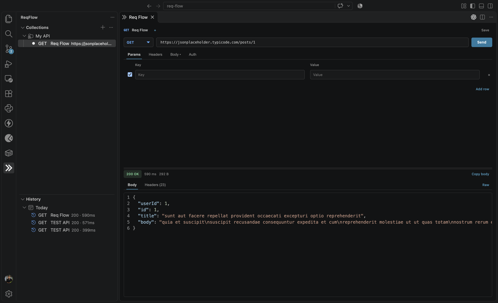

# ReqFlow: REST API Client & Tester

**Build, send, and inspect REST API requests without leaving VS Code.**

ReqFlow is a lightweight REST API client built directly into VS Code. Create, organize, and test API requests without switching between tools.



## Features

- Build requests with common HTTP methods, query parameters, headers, JSON or form bodies, and Bearer or Basic auth.
- Send requests, inspect response bodies and headers, cancel in-flight requests, and reopen recent history.
- Organize saved requests in collections and folders; duplicate, rename, and open requests in pinned tabs.
- Use named environments with `{{variable}}` substitution and a status bar picker.
- Import requests from cURL or copy a saved request as cURL.

## Keyboard shortcuts (request panel)

| Action      | Windows / Linux | macOS       |
|-------------|-----------------|-------------|
| Send        | `Ctrl+Enter`    | `Cmd+Enter` |
| Save        | `Ctrl+S`        | `Cmd+S`     |
| Rename      | `F2`            | `F2`        |
| Focus URL   | `Ctrl+L`        | `Cmd+L`     |
| Cancel send | `Escape`        | `Escape`    |
| New request | `Ctrl+Alt+N`    | `Cmd+Alt+N` |

## Quick start

1. Install **ReqFlow: REST API Client & Tester** from the [VS Code Marketplace](https://marketplace.visualstudio.com/items?itemName=piyushpriyadarshi.reqflow-api-client), or from the terminal:

   ```bash
   code --install-extension piyushpriyadarshi.reqflow-api-client
   ```

2. Click the **ReqFlow** icon in the activity bar.
3. Open **Sample GET** under **Collections**, choose **local** in the status bar if needed, and press **Send**.

## Privacy and storage

- Request data, environment values, and response history are stored in VS Code global storage on your machine, not in your workspace. History includes the request details and response.
- When you send a request, ReqFlow sends it from the VS Code extension host to the URL you chose. Auth details are included when configured. Use credentials only with APIs you trust.
- ReqFlow has no account, cloud sync, or telemetry.

## Support and feedback

- Found a bug or want a feature? [Open an issue](https://github.com/thePiyushPriyadarshi/req-flow/issues).
- Enjoying ReqFlow? A rating on the [Marketplace page](https://marketplace.visualstudio.com/items?itemName=piyushpriyadarshi.reqflow-api-client&ssr=false#review-details) helps other developers find it.

See [CHANGELOG.md](CHANGELOG.md) for release notes.

ReqFlow is an independent project and is not affiliated with Postman or any other API client mentioned here.

## About the author

Built by **Piyush Priyadarshi**.

- GitHub: [github.com/thePiyushPriyadarshi](https://github.com/thePiyushPriyadarshi)
- Portfolio: [piyushpriyadarshi.in](https://piyushpriyadarshi.in)

## License

MIT. See [LICENSE](LICENSE).
